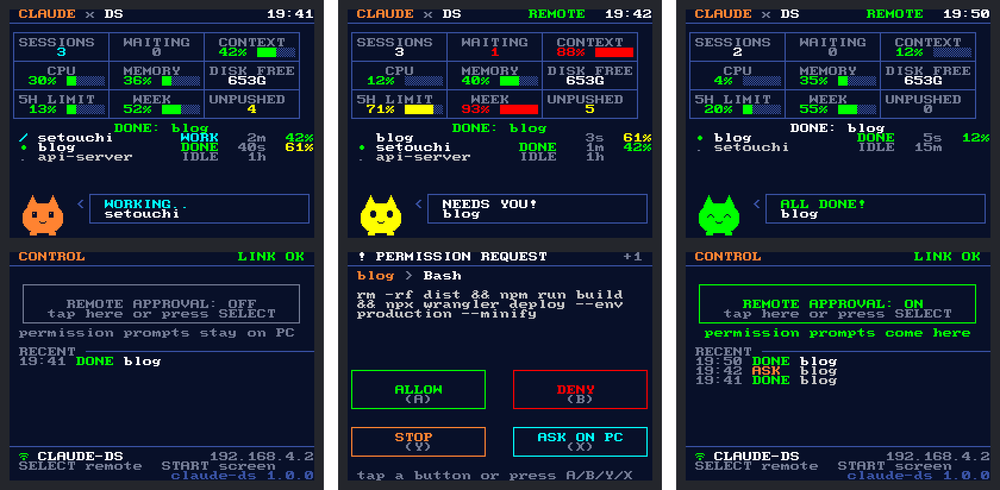

# Claude DS — 원조 닌텐도 DS로 보는 Claude Code 상태판

집에 있는 **원조 닌텐도 DS(또는 DS Lite) + R4 같은 SD카드 카트리지**를 Claude Code 상태판 겸 리모컨으로 쓰는 프로젝트예요.



- **위 화면**: 세션 수, 내 응답을 기다리는 세션, 컨텍스트 사용률, CPU·메모리·디스크, 5시간/주간 사용량, 푸시 안 한 커밋, 세션 목록, 상태에 따라 표정이 바뀌는 캐릭터
- **아래 화면**: 권한 요청이 오면 **허용 / 거절 / 중지 / PC에서 묻기** 버튼, 원격 승인 켜기/끄기, 최근 알림
- **소리**: 작업이 끝나면 "띠리링", 확인이 필요하면 "삐삐"
- **덮개를 닫아도** 화면만 꺼지고 계속 돌아가요 (알림 소리는 그대로)

> ⚠️ 이 버전은 아직 **실제 기기에서 테스트하지 않은 첫 버전**이에요. PC 프로그램은 자동 테스트를 통과했고, DS 앱과 ESP32 펌웨어는 GitHub에서 빌드까지 확인했어요. 막히는 부분이 있으면 DS 아래 화면에 뜨는 상태 문구와 PC 창의 메시지를 알려주세요.

## 어떻게 연결되나요

```
Claude Code ──(훅)──▶ PC 브리지(파이썬) ──USB──▶ ESP32 ~~ DS 전용 와이파이 ~~▶ 닌텐도 DS
```

원조 DS에는 PC와 데이터를 주고받을 USB 단자가 없어요. 와이파이도 **비밀번호 없음/WEP + 802.11b**만 지원해서 요즘 공유기에는 못 붙어요. 그래서 PC에 꽂은 **ESP32 보드가 DS 전용 작은 와이파이("CLAUDE-DS")**를 만들어 줘요.

- 이 와이파이는 집 네트워크나 인터넷과 **연결되지 않아요**. ESP32는 짧은 문자 줄만 주고받아요.
- ESP32는 **처음 접속한 DS 한 대만 기억**하고, 다른 기기는 내보내요.

## 준비물

| 물건 | 비고 |
| --- | --- |
| 닌텐도 DS (원조 / DS Lite) | DSi·3DS에서도 DS 모드로 동작해요 |
| R4 같은 SD카드 카트리지 + microSD | 오래된 R4는 **2GB 이하** microSD만 읽는 경우가 많아요 |
| ESP32 개발보드 1개 | "ESP32 개발보드"(ESP-WROOM-32) 추천, 5천~1만 원대. ESP32-C3 SuperMini도 가능 |
| 데이터 전송이 되는 USB 케이블 | 충전 전용 케이블은 안 돼요 |
| Claude Code가 돌아가는 PC | Windows / Mac / Linux, Python 3.8 이상 |

## 설치

### 1. 파일 받기

GitHub의 **Actions** 탭 → 가장 최근 `claude-ds` 실행 → 아래쪽 **Artifacts**에서 내려받아요.

- `claude-ds-nds` → `claude-ds.nds` (DS 앱)
- `claude-ds-esp32-firmware` (일반 ESP32) 또는 `claude-ds-esp32c3-firmware` (ESP32-C3)

PC 프로그램은 이 폴더의 `bridge/`에 있어요 (저장소를 ZIP으로 받거나 `git clone`).

### 2. ESP32에 펌웨어 넣기 (5분)

1. 크롬이나 엣지에서 <https://espressif.github.io/esptool-js/> 를 열어요.
2. ESP32를 USB로 꽂고 **Connect**를 눌러 포트를 골라요. 안 잡히면 보드의 **BOOT 버튼을 누른 채로** 다시 시도해요.
3. Flash Address에 `0x0`, 파일은 `claude-ds-esp32-flash-at-0x0.bin`(C3는 `...esp32c3...`)을 골라 **Program**을 눌러요.
4. 끝나면 보드를 뺐다가 다시 꽂아요. 폰 와이파이 목록에 `CLAUDE-DS`가 보이면 성공이에요.

Arduino IDE를 쓴다면 `esp32/claude_ds_ap/claude_ds_ap.ino`를 열고 보드를 "ESP32 Dev Module"로 골라 업로드해도 돼요. ESP32-C3라면 "ESP32C3 Dev Module"을 고르고 "USB CDC On Boot: Enabled"로 바꿔요.

### 3. DS에 앱 넣기

`claude-ds.nds`를 microSD에 복사하고 R4 메뉴에서 실행해요. 아래 화면에 주변 와이파이 목록과 연결 상태가 나와요.

### 4. PC 프로그램(브리지) 실행

```bash
cd claude-ds/bridge
pip install pyserial psutil
python claude_ds_bridge.py --install-hooks   # 처음 한 번만: Claude Code 설정에 훅 추가
python claude_ds_bridge.py                   # 실행 (ESP32는 자동으로 찾아요)
```

- Windows에서는 `python` 대신 `py`일 수 있어요.
- 훅을 설치한 뒤에는 **열려 있던 Claude Code 세션을 다시 시작**해야 적용돼요.
- Claude 없이 화면부터 보고 싶다면 `python claude_ds_bridge.py --demo`로 가짜 세션을 띄워 보세요.
- Claude Code에게 "claude-ds/README.md 보고 브리지 설치해줘"라고 시켜도 돼요.

## 사용법

| 버튼 | 기능 |
| --- | --- |
| **A / B / Y / X** | 권한 요청: 허용 / 거절 / 중지(Claude 멈춤) / PC에서 묻기 |
| **SELECT** | 원격 승인 켜기·끄기 |
| **START** | 화면 끄기·켜기 |
| **R** | 소리 끄기·켜기 |
| **터치** | 아래 화면의 버튼 |
| **덮개 닫기** | 화면만 꺼지고 계속 동작 |

**원격 승인**

- **OFF (기본)**: 권한 요청은 평소처럼 PC 화면에 떠요. DS는 "확인 필요" 알림만 해요.
- **ON**: 권한 요청이 DS로 와요. 그동안 PC 화면에는 안 떠요. DS에서 **ASK ON PC**를 누르거나 DS 연결이 끊기면 PC 화면으로 넘어가요.
- ON일 때는 DS가 사실상 승인 버튼이니, 자리를 비울 때 켜고 돌아오면 꺼 두세요.

**위 화면 칸**

| 칸 | 뜻 |
| --- | --- |
| SESSIONS / WAITING | 열린 세션 수 / 내 응답을 기다리는 세션 수 |
| CONTEXT | 세션 중 가장 많이 찬 컨텍스트 % |
| CPU / MEMORY / DISK FREE | PC 상태 (`psutil`이 있어야 CPU·메모리 표시) |
| 5H LIMIT / WEEK | 구독 사용량 (5시간 / 주간) |
| UNPUSHED | 작업 중인 저장소들의 푸시 안 한 커밋 수 |

CONTEXT, 5H, WEEK는 Claude Code 상태줄(statusline) 정보를 쓰기 때문에, 이미 다른 상태줄을 쓰고 있으면 비어 있어요. 설치 프로그램은 쓰던 상태줄을 덮어쓰지 않아요.

## 문제 해결

| 증상 | 확인할 것 |
| --- | --- |
| DS가 `CLAUDE-DS`를 못 찾음 | ESP32가 USB에 꽂혀 있는지, 펌웨어가 들어갔는지 (폰 와이파이 목록에 보이는지) |
| DS에 `Wi-Fi OK! Waiting for the PC program` | PC에서 `python claude_ds_bridge.py` 실행 |
| PC 창에 "ESP32를 찾는 중..." | `python claude_ds_bridge.py --list-ports`로 포트를 확인하고 `--port COM5`처럼 지정 |
| DS를 다른 기기로 바꿈 | `python claude_ds_bridge.py --unpair` (브리지는 끄고 실행) |
| 훅을 지우고 싶음 | `python claude_ds_bridge.py --uninstall-hooks` |

## 고급: ESP32 없이 공유기로

공유기에서 **비밀번호 없음 또는 WEP + 802.11b**를 허용하는 와이파이를 따로 만들 수 있다면 ESP32 없이도 돼요. 이런 와이파이는 보안이 약하니 집 네트워크와 분리하는 걸 권해요. microSD에서 `claude-ds.nds` 옆에 `claude-ds.ini`를 만들어요.

```ini
ssid=내-공유기-와이파이-이름
key=12345                ; WEP 키(5자 또는 13자), 비밀번호가 없으면 비워 두기
server=192.168.0.10      ; PC의 IP 주소
port=7777
token=길고-아무도-모르는-값
```

PC에서는 이렇게 실행해요: `python claude_ds_bridge.py --tcp 0.0.0.0:7777 --token 길고-아무도-모르는-값`

## 개발자용

- 통신 규약: [PROTOCOL.md](PROTOCOL.md)
- 테스트: `cd bridge && python -m unittest discover -s tests` / `make -C ds/tests` (DS 화면을 텍스트로 출력)
- DS 빌드: [BlocksDS](https://blocksds.skylyrac.net) 설치 후 `make -C ds`, 또는 `docker run --rm -v "$PWD/ds":/work skylyrac/blocksds:slim-latest make`
- 화면 미리보기 PNG: `python ds/tools/render_preview.py ds/tests/build/screens.json <libnds의 default_font.png> out/`
- 캐릭터 타일·아이콘 다시 만들기: `python ds/tools/gen_buddy.py`

DS 글꼴은 영문만 있어서, 한글 폴더 이름이나 명령은 `?`로 보여요.
